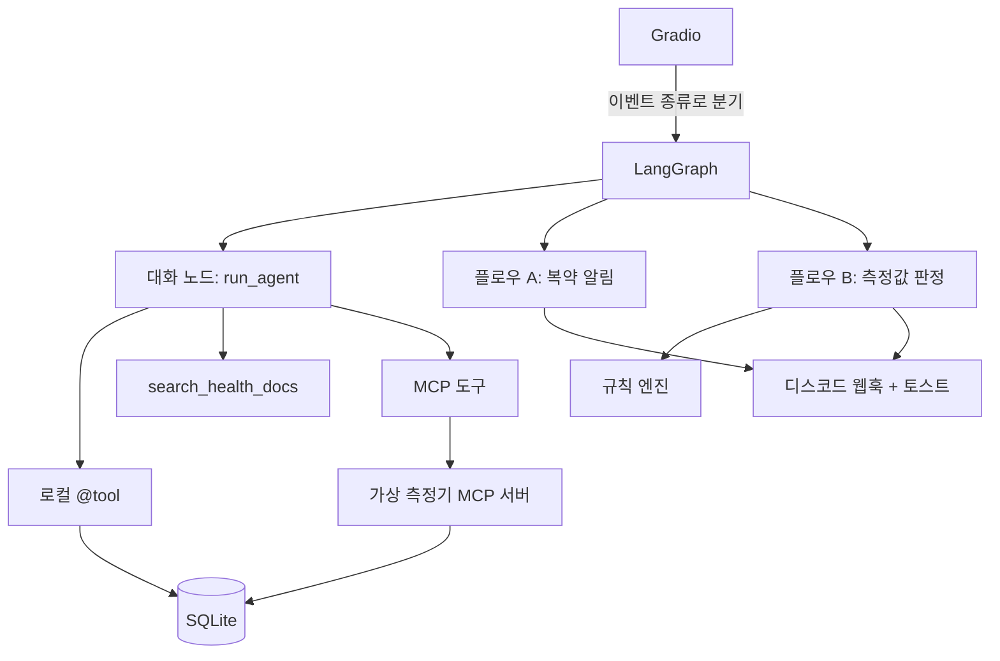

# 복약·측정 에이전트 — 아키텍처 명세서 (Architecture Spec)

> A. 아키텍처, B. 파일 구조. 도구·데이터는 `health_agent_tool_data_spec.md`. 기능은 `health_agent_feature_spec.md`, 배경·일정·역할은 기획서를 본다.
> 이름·인자·컬럼은 초안이며 구현하면서 확정한다.

---

## A. 아키텍처
> 이 문서는 `health_agent_feature_spec.md`(기능), `health_agent_tool_data_spec.md` C절(도구·MCP), `health_agent_tool_data_spec.md` D절(데이터)를 기반으로 코드 구조와 실행 흐름을 정의한다.

### 1. 개요

| 영역 | 스택 | 비고 |
|---|---|---|
| 화면 | Gradio | `app.py` |
| 에이전트 루프 | 수업 3장 `run_agent` (async) | `agent/` |
| LLM | Google Gemini 무료 API (`ChatGoogleGenerativeAI`) | 3.0절 참고 |
| 플로우 | LangGraph + `InMemorySaver` | `graph/` |
| RAG | `bge-m3` + FAISS | `rag/` |
| 측정기 | FastMCP 가상 측정기 서버 | `mcp_server/` |
| 데이터 | SQLite | `data/health.db` |
| 알림 | 디스코드 웹훅 + Gradio 토스트 | `notify/` |



### 2. 디렉토리 구조

> 파일 단위 상세는 B절.

```
health-agent/
├─ app.py                  # Gradio 화면
├─ agent/                  # run_agent, 도구 등록, 시스템 프롬프트, 대화 기억
├─ graph/                  # reminder_flow.py, measurement_flow.py
├─ tools/                  # 복약 기록, 리포트, 규칙 엔진
├─ rag/                    # docs/, build_index.py, search.py
├─ mcp_server/             # device_server.py
├─ notify/                 # discord_notify.py  (discord.py 이름 금지: 라이브러리를 가림)
├─ data/                   # generate_fake_data.py, health.db
├─ .env.example
└─ README.md               # 실행 방법 + 사용 기술 4개 명시
```

### 3. 실행 흐름

#### 3.0 LLM 선택 (`agent/llm.py`)

| 항목 | 내용 |
|---|---|
| 패키지 | `langchain-google-genai` |
| 클래스 | `ChatGoogleGenerativeAI(model=GEMINI_MODEL)` |
| 키 | `GOOGLE_API_KEY` (Google AI Studio 무료 발급) |

- `bind_tools` / `ainvoke` / `ai.tool_calls`를 지원하므로 `run_agent` 루프는 수업 구조 그대로. 모델 생성은 `llm.py` 한 곳.
- 무료 등급은 분당·일당 요청 한도가 있다. 시연 중 한도 초과를 막으려고 시연 직전 반복 테스트를 줄이고, 한도 오류는 문장으로 화면에 표시한다.
- 무료 등급 입력은 Google 제품 개선에 쓰일 수 있다. 가상 데이터만 쓰므로 허용하되 보고서 "보안·윤리·비용" 장에 적는다.
- 모델 이름과 한도는 발급 시점에 AI Studio에서 확인해 `GEMINI_MODEL`에 넣는다.
- 인터넷이 필요하다 → 시연용 휴대폰 핫스팟 예비, 3분 시연 영상 필수.
- 안내서 3쪽 필수 요건은 "로컬 LLM — Ollama 모델(EXAONE·Qwen) 실행"이다. Gemini만 쓰면 이 항목이 '미흡' 처리될 수 있다 → 교수님께 확인 필요 (기획서 20절).

#### 3.1 대화 노드 (`run_agent`)

수업 3장 구조를 유지하고 모델 부분만 Gemini로 바꾼다. 루프·로그·승인(`NEED_APPROVAL`)·반복 상한(`max_iters`)·대화 기억은 그대로.

```python
ai = await llm_with_tools.ainvoke(messages)
calls = ai.tool_calls
messages.append(ai)
result = await tmap[c['name']].ainvoke(c['args'])   # MCP 도구가 비동기 전용
messages.append(ToolMessage(str(result), tool_call_id=c['id']))
```

도구 리스트 = 로컬 `@tool` + `search_health_docs` + `MultiServerMCPClient(...).get_tools()`.

#### 3.2 플로우 B: 측정값 판정

```
judge (규칙)
 ├ 정상          → save → END
 ├ 범위 밖       → save → explain (LLM) → END
 ├ 측정 오류 의심 → recheck(interrupt) → judge   (state.recheck_count ≤ 1)
 └ 위험          → emergency (고정 문구) → notify_guardian → save → END
```

#### 3.3 플로우 A: 복약 알림

```
send_reminder → wait_check(interrupt)
 ├ taken             → record_taken → END
 ├ no_response (1회) → send_reminder
 └ no_response (2회) → notify_guardian → record_missed → END
```

#### 3.4 LangGraph 구현 규칙

- 체크포인터 `InMemorySaver`, 복약 1회마다 별도 `thread_id` (예: `2026-11-20-morning`). 재개는 `Command(resume=...)`.
- 재개 시 노드가 처음부터 재실행된다 → **디스코드 전송 노드와 interrupt 노드는 반드시 분리** (중복 발송 방지).
- 재측정은 노드 안 반복문이 아니라 조건 엣지 + state 카운터로 1회 제한.

### 4. 판정·권한 경계

| 결정 | 누가 | 이유 |
|---|---|---|
| 도구 선택, 설명 문장 | LLM | |
| 범위·위험 판정 | 규칙 엔진 (코드) | LLM이 위험 수치를 "괜찮다"고 답하는 사고 방지 |
| 응급 문구 | 고정 문자열 | LLM 거치지 않음 |
| 알림 발송 | 그래프 | LLM이 고르지 않음, 확정적으로 발송 |
| 환자 식별 | 서버 변수 (`LOGIN_ID` 패턴) | 도구 인자에서 제거 → 다른 환자 조회 불가 |

위험 기준 숫자는 RAG에 넣은 공식 자료에서 가져오고 출처를 표시한다.

### 5. 환경

`.env` (커밋 금지, `.env.example`만 저장소에 올림)
```
GOOGLE_API_KEY=
GEMINI_MODEL=
DISCORD_WEBHOOK_PATIENT=
DISCORD_WEBHOOK_GUARDIAN=
```

- 첫날: AI Studio에서 키 발급 → 도구 1개를 `bind_tools`로 붙여 `ai.tool_calls`가 나오는지 확인
- 임베딩 디바이스: Mac `mps`, Windows `cuda`
- 임베딩·FAISS 인덱스·가상 데이터는 로컬에 미리 준비 (LLM 호출만 인터넷 사용)

---

## B. 파일 구조
> A절 2절의 폴더 구조를 파일 단위로 풀어 쓴 문서다. 파일 이름·분할은 초안이며 구현하면서 확정한다.
> 담당 열은 기획서 18절의 예시안(A/B)을 따른다.

### 1. 전체 트리

```
health-agent/
├─ app.py                       # Gradio 진입점: 채팅·로그창·복약 버튼·가상 시계·리포트 다운로드
├─ config.py                    # .env 로드, LOGIN_ID(고정 환자 ID), 경로 상수
├─ requirements.txt
├─ .env.example                 # 키 이름만, 값 없음
├─ .gitignore                   # .env, data/health.db, rag/index/, reports/
├─ README.md                    # 실행 방법 + 사용 기술 4개
│
├─ agent/
│  ├─ llm.py                    # ChatGoogleGenerativeAI 생성 (GOOGLE_API_KEY, GEMINI_MODEL)
│  ├─ run_agent.py              # 수업 3장 루프 (async): tool_calls → ainvoke → ToolMessage
│  ├─ tool_registry.py          # 로컬 @tool + RAG 도구 + MCP 도구를 한 리스트로, NEED_APPROVAL
│  ├─ memory.py                 # 대화 기억 (최근 12개)
│  └─ prompts.py                # 시스템 프롬프트 (정보 안내까지만, 진단·용량 판단 거절)
│
├─ graph/
│  ├─ state.py                  # 플로우 A·B State 정의 (reminder_count, recheck_count 등)
│  ├─ reminder_flow.py          # 플로우 A: send_reminder → wait_check(interrupt) → 분기
│  ├─ measurement_flow.py       # 플로우 B: judge → save / explain / recheck / emergency
│  └─ router.py                 # Gradio 이벤트 종류 → 대화 노드 / 플로우 A / 플로우 B
│
├─ tools/
│  ├─ medication.py             # get_today_medications, check_medication
│  ├─ report.py                 # make_report (통계·그래프·질문 목록 PDF)
│  ├─ rules.py                  # 규칙 엔진: 범위·오류 의심·위험 판정, 고정 응급 문구
│  └─ db.py                     # SQLite 연결 헬퍼
│
├─ rag/
│  ├─ docs/                     # 공공 자료 PDF (허가정보, 국가건강정보포털)
│  ├─ index/                    # FAISS 인덱스 (build_index.py 결과물)
│  ├─ build_index.py            # PyPDFLoader → 500/50 분할 → bge-m3 → FAISS 저장
│  └─ search.py                 # search_health_docs (점수 임계값, 출처·쪽수)
│
├─ mcp_server/
│  └─ device_server.py          # FastMCP: get_blood_pressure / get_glucose / get_heart_rate
│
├─ notify/
│  └─ discord_notify.py         # 웹훅 전송 + 실패 기록 (discord.py 이름 금지)
│
├─ data/
│  ├─ generate_fake_data.py     # 가상 처방·측정값 생성 → health.db
│  └─ health.db                 # 생성물 (커밋 안 함)
│
├─ assets/
│  └─ fonts/NanumGothic.ttf     # 리포트 PDF 한글 폰트
│
└─ reports/                     # 생성된 리포트 PDF (커밋 안 함)
```

### 2. 파일 ↔ 기능·담당 대응

| 파일 | 기능 (feature spec) | 기술 | 담당(예시) |
|---|---|---|---|
| `agent/llm.py`, `agent/run_agent.py`, `agent/tool_registry.py` | 전체 | 도구 호출 | A |
| `tools/medication.py` | F01, F02 | 도구 호출 | A |
| `rag/build_index.py`, `rag/search.py` | F03 | RAG | B |
| `mcp_server/device_server.py` | F04 | MCP | A |
| `tools/rules.py`, `graph/measurement_flow.py` | F05 | LangGraph | A |
| `graph/reminder_flow.py`, `notify/discord_notify.py` | F07, F09 | LangGraph | A |
| `app.py` (가상 시계 포함) | F06, 공통 | Gradio | B |
| `tools/report.py` | F08 | 도구 호출 | B |
| `agent/prompts.py` | 전체 | | B |
| `data/generate_fake_data.py` | 전체 | | A |

### 3. 실행 순서

```bash
pip install -r requirements.txt
cp .env.example .env                 # 값 채우기
python data/generate_fake_data.py    # health.db 생성
python rag/build_index.py            # FAISS 인덱스 생성
python app.py                        # MCP 서버는 MultiServerMCPClient가 stdio로 띄움
```

> MCP 서버를 stdio로 띄울지 별도 프로세스(HTTP)로 띄울지는 미정. stdio면 `app.py` 하나로 실행된다.
